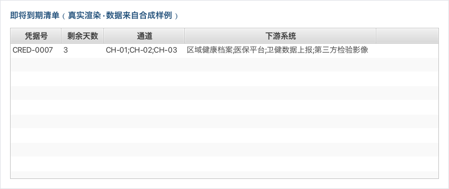
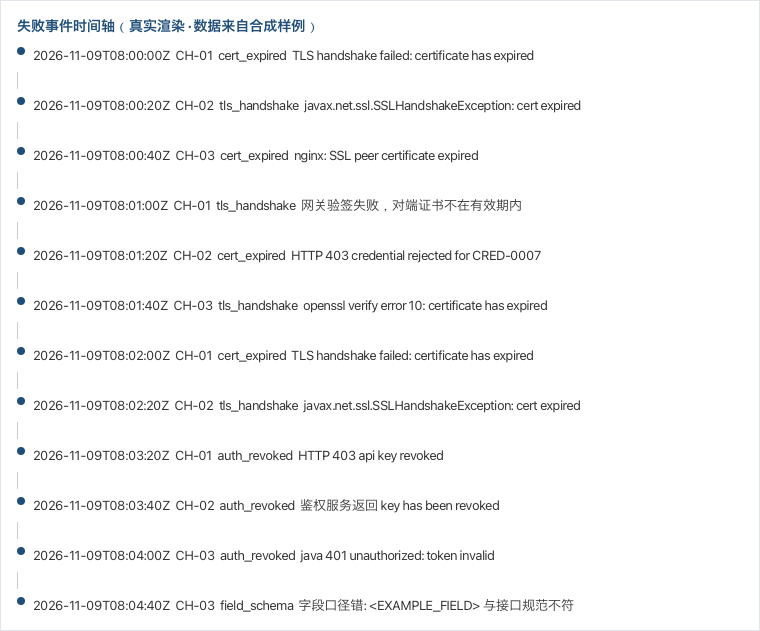
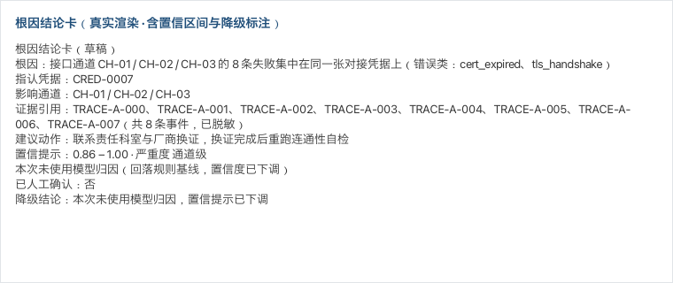
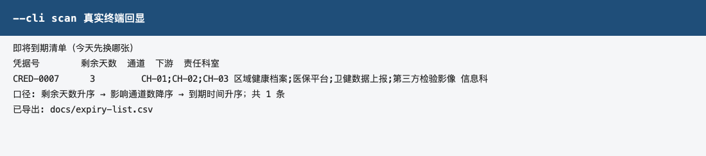
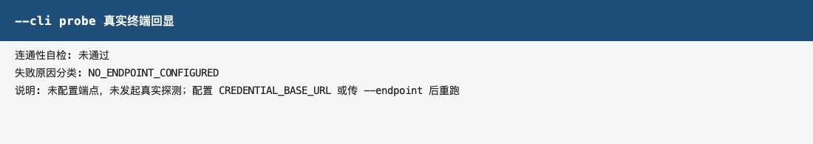
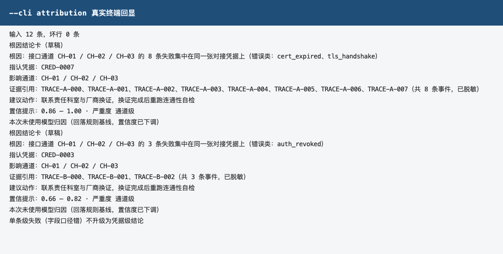

# 接口账号密钥轮换系统

> 信息科把对外接口的账号、密码、证书、API Key 导进来，桌面端常驻盯着接口失败事件流：证书到期前三天点出「今天必须先换哪张、影响哪几个下游系统」；某天几个系统一起报错时直接给出「本次失败集中在这一张凭据上」的根因结论与脱敏证据，人工确认后写回处置单，换证完成后跑一次真实连通性自检，通过才推进「已验证」并关单。

这套工具面向医院信息科的**对外接口凭据**（与患者诊疗数据无关）。它替信息科干三件事：**到期前排期**、**批量失效时定位是哪一张凭据**、**换完证把单子闭上**。工具常驻运行，状态落在本地状态库里；窗口关掉之后仍继续订阅。

---

## 适用场景 / 目标岗位

| 岗位 | 什么时候用 | 得到什么 |
|------|------------|----------|
| 信息科 集成运维岗 | 年度 / 季度集中换证前 | 当天必须先换的凭据清单：剩余天数、关联通道、影响的下游系统、责任科室与换证入口 |
| 信息科 集成运维岗 | 早班四五个系统同时报错 | 一条根因结论：「本次失败集中指向这一张凭据」+ 脱敏证据片段 + 置信提示 + 建议动作 |
| 科室 对外接口对接人 | 厂商催换证、要一份书面说明 | 可直接贴给厂商的处置单正文：根因、影响范围、到期时间、建议动作 |
| 信息科 安全管理员 | 季度 / 年度审计 | 换证闭环记录：谁在何时以何理由派了哪张证的单、自检结论与模型调用元数据 |

## 能力要点

- **到期前三天点名**：按「剩余天数 → 影响通道数 → 到期时间」排序，一次给出今天先换哪张证、挂了哪几个下游、该找谁换、换证入口在哪；导出 CSV 直接进排期会与科室交办。
- **异构报错归到同一张凭据上**：三条通道各抛不同技术栈的报错文本，聚成一条根因并指认具体凭据；同期一条字段口径错导致的单条失败**不会**被误聚进来。
- **结论先给草稿**：模型归因输出永远只是草稿，必须人工勾选「已人工确认」并二次确认，才会真正外发处置单；模型不可达时自动回落规则归因并在结论卡上显式标注。
- **换完证先测再上**：对通道发真实 TLS / HTTP 握手并读证书有效期，探测通过才允许把凭据推进到「已验证」；不通过则停在「已轮换」并记下失败原因。
- **队列满了不静默丢**：事件队列满时**拒收并计数**，界面底部队列深度变黄并提示「即将拒收」；原始事件另有归档档留证，可按保留期清理。
- **明文永不留痕**：只存凭据指纹（HMAC-SHA256 截断 16 位），任何表、日志、导出文件都检索不到凭据明文。

## 快速开始

### 依赖

| 项 | 要求 |
|---|---|
| JDK | 17 及以上（推荐 **JDK 17**，桌面端按 JDK 17 校验） |
| 构建工具 | Maven 3.8 及以上 |
| 院内可达 | 接口引擎（失败事件流）、凭据台账服务 |
| 可选 | OpenAI-compatible 推理端点；**不配也能跑**，此时结论卡会标注「本次未使用模型归因」 |

### 安装

```bash
cd interface-credential-rotation

# macOS 指定 JDK 17；Linux 改为 export JAVA_HOME=/usr/lib/jvm/java-17-openjdk
export JAVA_HOME=$(/usr/libexec/java_home -v 17)

# 预取依赖（院内离线机器：在有网机器上先跑一次，~/.m2 整目录拷过去）
mvn -q dependency:go-offline
```

### 配置

凭据位一律由**环境变量**注入。程序自身不扫描 `.env` 文件、也不带任何本地默认地址；把 `.env.example` 复制成 `.env` 填好后，由 shell / 服务管理器导出为环境变量即可。

```bash
cp .env.example .env
$EDITOR .env                       # 填写院内真实地址与令牌，不要提交 .env

set -a && . ./.env && set +a       # 导出为环境变量
# systemd 可改用 EnvironmentFile=/opt/icr/icr.env；Windows 计划任务用「环境变量」页签
```

### 构建与验证

```bash
mvn -q -DskipTests package        # 产出 target/interface-credential-rotation.jar
mvn -q test                       # JUnit 5 全量测试套件（逐项覆盖 51 个任务的 proof 断言）
mvn -q javafx:run                 # 启动桌面端（主路径，常驻托盘）
```

`java -jar` 的清单里已写入 `Class-Path: dependency/...`，因此 **jar 必须与 `target/dependency/` 一起拷贝**；
桌面端由 `javafx-maven-plugin` 或 `jpackage` 以模块路径启动，细节见 `docs/cli.md`。

### 主命令速查

```bash
mvn -q javafx:run                                              # 启动桌面端（主入口）
java -jar target/interface-credential-rotation.jar --cli doctor  # 配置齐全性与端点可达性自检
java -jar target/interface-credential-rotation.jar --cli scan    # 到期扫描：今天先换哪张证
java -jar target/interface-credential-rotation.jar --cli probe   # 真实连通性自检（TLS / HTTP 握手）
java -jar target/interface-credential-rotation.jar --cli ticket --confirm   # 人工确认后派发处置单
java -jar target/interface-credential-rotation.jar --cli audit   # 导出季度审计记录
```

## 命令 / API / 配置说明

### 关键配置项

| 配置项 | 默认值 | 说明 |
|--------|--------|------|
| `ESB_BASE_URL` | 无（必填） | 接口引擎基地址，失败事件流从这里拉 |
| `ESB_TOKEN` | 无（必填） | 事件流访问令牌，对应请求头 `authorization: bearer` |
| `CREDENTIAL_BASE_URL` | 无（必填） | 凭据台账基地址，读台账与写回处置单 / 自检结论 |
| `CREDENTIAL_TOKEN` | 无（必填） | 台账访问令牌，读写共用同一凭据位 |
| `MODEL_BASE_URL` | 无（缺省则关闭模型路径） | OpenAI-compatible 推理端点基地址 |
| `MODEL_API_KEY` | 无（缺省则关闭模型路径） | 推理端点令牌 |
| `MODEL_NAME` | 无（缺省则关闭模型路径） | 模型名 |
| `MODEL_TIMEOUT_MS` | 20000 | 单次调用超时（毫秒） |
| `MODEL_MAX_RETRIES` | 2 | 5xx / 429 时的最大重试次数；4xx 不重试直接降级 |
| `MODEL_MAX_INPUT_EVENTS` | 200 | 单次归因最多带入的失败事件条数 |
| `FINGERPRINT_KEY` | 无（必填） | 计算凭据指纹的 HMAC-SHA256 密钥，无默认值；更换此值会使历史指纹失效，需与运维约定后统一轮换 |

### CLI 子命令 / 接口端点

| 命令或路径 | 用途 | 关键参数 |
|------------|------|----------|
| `--cli doctor` | 打印配置项齐全性与端点可达性结论（不发写请求） | 无 |
| `--cli scan` | 到期扫描：输出当天先换哪张证、影响哪些下游 | `--warn-days`（默认 7） |
| `--cli probe` | 真实连通性自检：TLS 握手读证书有效期 / HTTP 状态码 | `--credential-id`、`--channel` |
| `--cli ticket` | 人工确认后派发处置单（写回台账） | `--confirm`（**不带则拒绝外发**）、`--credential-id` |
| `--cli audit` | 导出季度审计记录（操作人 / 理由 / 时间 / 对象） | `--from`、`--to` |
| `--cli sync` | 同步凭据台账与失败事件流 | `--since` |
| `GET {esb_base_url}/api/v1/interface-failures` | 读接口失败事件流 | `since`、`limit`（≤200） |
| `GET {credential_base_url}/api/v1/integration-credentials` | 读对接凭据台账（只含元数据） | 无 |
| `POST {credential_base_url}/api/v1/credential-tickets` | 写回处置单 | 头 `idempotency-key` |
| `POST {credential_base_url}/api/v1/credential-verifications` | 写回自检结论 | 体含 `probe_result`、`verified_at` |

### 错误与降级

| 场景 | 表现 | 处理方式 |
|------|------|----------|
| 模型端点不可达 / 超时 / 返回不合规 | 结论卡标注「本次未使用模型归因」，置信提示下调 | 回落规则归因；**不推进任何状态**，调用元数据入审计 |
| 接口引擎不可达 | 心跳行显示「订阅：断连」，按退避重试 | 恢复后按 `since` 游标续拉，不重拉也不漏拉 |
| 凭据台账不可达 | 界面提示「台账不可达」，写回按钮禁用 | 只读本地缓存快照并**禁止写回** |
| 事件队列逼近上限 | 底部队列深度数字变黄并显示「即将拒收」 | 满时拒收并计数，事件不静默丢；另有归档档留证 |
| 指纹冲突 / 缺失（同指纹多 id、同 id 多指纹、缺任一） | 该批失败落入「人工处理」分区，**不生成结论卡** | 人工核对台账后重扫，绝不强行合并 |
| 探测不通过（证书过期 / 主机名不符 / 信任链不受信 / 连接被拒 / 超时） | 凭据状态停在「已轮换」并记失败码 | 换证完成后重跑自检，通过才推进「已验证」 |
| 处置单写回失败（重试 2 次仍失败） | 本地票据保持「待确认」，界面显示「写回失败，可重试」 | 人工重试；**不静默**改成已派发 |

### 对接现有系统

| 端点 | 方法 | 方向 | 鉴权位 | 关键字段 |
|---|---|---|---|---|
| `{esb_base_url}/api/v1/interface-failures` | GET | 读 | `authorization: bearer $ESB_TOKEN` | `channel_code`、`error_class`、`error_message`、`occurred_at`、`credential_fingerprint`、`trace_id`、`endpoint`、`upstream_service` |
| `{credential_base_url}/api/v1/integration-credentials` | GET | 读 | `authorization: bearer $CREDENTIAL_TOKEN` | `credential_id`、`channel_code`、`credential_type`、`expires_at`、`owner_dept`、`owner`、`rotation_entry`、`last_verified_at` |
| `{credential_base_url}/api/v1/credential-tickets` | POST | 写 | `authorization: bearer $CREDENTIAL_TOKEN` + `idempotency-key` | 体：`credential_id`、`root_cause`、`evidence_refs[]`、`due_at`、`state` |
| `{credential_base_url}/api/v1/credential-verifications` | POST | 写 | `authorization: bearer $CREDENTIAL_TOKEN` | 体：`credential_id`、`channel_code`、`probe_result`、`verified_at` |

凭据位全部来自环境变量；台账只提供元数据，响应里若出现疑似明文字段（`secret` / `password` / `private_key`）会被**拒绝解析**并记一条告警，不落库。脱敏替身只存在于 `src/test`，生产代码里没有本地默认地址。

## 典型场景

### 场景 1：换证季排期 —— 信息科周一上午出当天清单

1. 启动桌面端，程序按到期紧迫度排出「今天必须先换哪张证」。
2. 左栏卡片给出剩余天数、关联通道数、下游系统名、责任科室与换证入口。
3. 导出 CSV 带到排期会，按科室拆成交办清单。

```bash
java -jar target/interface-credential-rotation.jar --cli scan --warn-days 7
# 预期：一张到期清单表，列 = 凭据号 / 类型 / 剩余天数 / 通道 / 下游 / 责任科室 / 到期日
```

### 场景 2：早班四五个系统同时报错 —— 定位是哪张凭据

1. 桌面端时间轴出现一串不同技术栈的报错，底部显示队列深度。
2. 右栏给出一条根因结论：指认具体凭据、列出脱敏证据引用、给出建议动作与置信提示。
3. 同期那条字段口径错导致的单条失败不会被聚进来，单独留在时间轴上。

```bash
java -jar target/interface-credential-rotation.jar --cli sync
# 预期：一条根因结论卡，指认凭据号 + 证据引用条数；单条级失败不进入结论卡
```

### 场景 3：换完证关单 —— 自检通过才关

1. 厂商换完证，人工勾选「已人工确认」并二次确认，派发处置单（带幂等键，同一故障窗口不会重复派单）。
2. 换证完成后跑一次真实连通性自检：TLS 握手读证书有效期、HTTP 读状态码。
3. 探测通过才把凭据推进到「已验证」并关单；不通过则停在「已轮换」并记失败原因。

```bash
java -jar target/interface-credential-rotation.jar --cli probe --credential-id CRED-0007
java -jar target/interface-credential-rotation.jar --cli ticket --confirm --credential-id CRED-0007
# 预期：probe 通过后状态 = 已验证；ticket 因幂等键重复提交时不产生第二张单
```

## 输出样例

以下三段均为本仓库真实运行产物：CSV 取自 `docs/expiry-list.csv`（`--cli scan` 导出），
结论卡与终端回显取自 `logs/task3-cli-attribution.log`、`logs/task2-cli-doctor.log`。
样例数据由固定种子 `20261109` 生成，两次运行逐字节一致。

### 到期预警清单（CSV，UTF-8 带 BOM）

```csv
凭据号,类型,剩余天数,通道,下游,责任科室,到期日
CRED-0007,cert,3,CH-01;CH-02;CH-03,区域健康档案;医保平台;卫健数据上报;第三方检验影像,信息科,2026-10-15T00:00:00Z
```

### 根因结论卡（`--cli attribution --input samples/failures-sample.jsonl`）

```text
输入 12 条，坏行 0 条
根因结论卡（草稿）
根因：接口通道 CH-01 / CH-02 / CH-03 的 8 条失败集中在同一张对接凭据上（错误类：cert_expired、tls_handshake）
指认凭据：CRED-0007
影响通道：CH-01 / CH-02 / CH-03
证据引用：TRACE-A-000、TRACE-A-001、TRACE-A-002、TRACE-A-003、TRACE-A-004、TRACE-A-005、TRACE-A-006、TRACE-A-007（共 8 条事件，已脱敏）
建议动作：联系责任科室与厂商换证，换证完成后重跑连通性自检
置信提示：0.86 – 1.00 · 严重度 通道级
本次未使用模型归因（回落规则基线，置信度已下调）
单条级失败（字段口径错）不升级为凭据级结论
```

同批 12 条里另有一张 `CRED-0003` 的结论卡，以及 1 条字段口径错的单条失败；
那条单条失败**没有**进入任何结论卡的证据引用，grep `TRACE-C-001` 在输出中零命中。

### 终端回显（`--cli doctor`，未配置任何环境变量）

```text
配置项                      是否设置   用途
ESB_BASE_URL               未设置        接口引擎基地址（失败事件流）
ESB_TOKEN                  未设置        事件流访问令牌
CREDENTIAL_BASE_URL        未设置        凭据台账基地址
CREDENTIAL_TOKEN           未设置        台账读写令牌
MODEL_BASE_URL             未设置        推理端点基地址
MODEL_API_KEY              未设置        推理端点令牌
MODEL_NAME                 未设置        模型名
MODEL_TIMEOUT_MS           未设置        单次调用超时（毫秒）
MODEL_MAX_RETRIES          未设置        5xx / 429 最大重试次数
MODEL_MAX_INPUT_EVENTS     未设置        单次归因最多输入事件数
FINGERPRINT_KEY            未设置        指纹 HMAC 密钥（无默认值）
必需项缺失数: 5
模型路径: 未配置，归因走规则基线
端点可达性: 使用 --check-reachability 显式探测（默认不发任何网络请求）
```

## 实测数据与对比基准

| 产物 | 路径 | 实测值 |
|------|------|--------|
| 合成样例校验 | `reports/sample-validation.json` | 741 条失败事件 / 8 条凭据 / 3 条通道；场景 A=373、B=123、C=62、D=45、E=138；无指纹事件 220 条；重复上报组 69 组 |
| 对比基准 | `reports/attribution-benchmark.json` | 规则基线 precision=1.0000、recall=0.8091；模型参与 precision=0.9514、recall=0.9874；误聚案例 48 条，逐条列出事件 id |
| 到期清单 | `docs/expiry-list.csv` | 1 条入选（CRED-0007，剩余 3 天，影响 3 条通道），表头固定 7 列 |

基准里「模型参与」路径在断网条件下使用确定性语义推断替身，报告 `model_mode` 明确标注为
`offline-deterministic-stand-in`，**不是**真实生产模型端点的成绩，不得对外当作模型能力承诺。

## 概念 / 实测对照

### 视觉目标

`docs/concepts/visual-goal.md` 记录结构化视觉目标卡（三状态 / 画面类型 / 配色与字体层级 / 必须可达的约束），要点如下：

- **画面类型**：桌面窗口（JavaFX）+ 系统托盘常驻。不做 Web 大屏、不做折线图表库。
- **三状态**：起始态「尚未订阅事件流」→ 首个可用瞬间「顶部三枚关键数字跳动、即将到期区出现一张证书卡片」→ 成形态「左栏色带清单 / 中栏失败时间轴 / 右栏根因结论卡 + 底部心跳行」。
- **配色**：主色 `#1F4E79`、告警红 `#C0392B`、预警橙 `#E67E22`、正常绿 `#27AE60`、背景 `#F5F6F8`、卡片白 `#FFFFFF` + 1px `#E1E4E8` 描边、时间轴连线 `#C7CDD4`。
- **字体层级**：中文回退链 Microsoft YaHei → PingFang SC → SansSerif；数值用等宽 JetBrains Mono → monospace，保证列对齐。
- **必须可达**：只用 JavaFX 标准控件（`TableView` / `ScrollPane` / `Label` / `Button` / `ToggleButton` / `ProgressBar`）与 AWT `SystemTray`；时间轴用纵向 `VBox` + 圆点 `Circle` 表达；不引第三方图表库、不用 `WebView`、不内嵌字体文件。

### 实测证据

`docs/screenshots/` 下 6 张图全部由真实运行采集：3 张是 JavaFX 窗口区域的实际渲染快照
（`ScreenshotCapture` 走 `applyCss` + `layout` + `snapshot`），3 张是 `--cli` 子命令真实标准输出
逐行绘制的终端回显图（`TerminalCapture` 读取 `logs/` 下当次执行日志），不是设计稿、不是事后效果补图。

| 截图 | 内容 | 采集方式 |
|------|------|----------|
| `docs/screenshots/01-expiry-list.png` | 左栏即将到期清单：凭据号 / 剩余天数 / 通道 / 下游系统 | JavaFX `TableView` 真实渲染 |
| `docs/screenshots/02-failure-timeline.png` | 中栏失败事件时间轴：圆点连线 + 脱敏报错摘要 | JavaFX `VBox` + `Circle` + `Line` 真实渲染 |
| `docs/screenshots/03-root-cause-card.png` | 右栏根因结论卡：草稿标注、置信区间、降级提示 | JavaFX `Label` 真实渲染 |
| `docs/screenshots/04-cli-scan.png` | `--cli scan --as-of … --export …` 的完整终端回显 | `TerminalCapture` 读 `logs/task47-cli-scan.log` |
| `docs/screenshots/05-cli-probe.png` | `--cli probe` 未配置端点时的「未通过」结论 | `TerminalCapture` 读 `logs/task47-cli-probe.log` |
| `docs/screenshots/06-cli-attribution.png` | `--cli attribution` 输出两张结论卡且不含单条失败引用 | `TerminalCapture` 读 `logs/task3-cli-attribution.log` |

三张窗口图逐张看：







三张终端回显图逐张看：







> **诚实标注**：本节上方「视觉目标」是结构化目标卡，下方是真实运行截图。目标里的色带、圆点时间轴、
> 置信区间呈现在实现中做了取舍，两张图并不完全一致；这里不声称一致，也不生成事后效果图去抹平差距。
> `--cli probe` 那张展示的是**未配置端点时的未通过结论**，不是探测成功画面，避免把降级图当作连通性成果。

## 架构与数据流

```
┌────────────────────────┐
│ 接口引擎失败事件流      │  GET /api/v1/interface-failures?since=…&limit=200
└───────────┬────────────┘  authorization: bearer $ESB_TOKEN
            ▼
┌────────────────────────┐
│ 订阅轮询（30 秒增量）    │  since 游标持久化到本地状态库，重启不丢
└───────────┬────────────┘
            ▼
┌────────────────────────┐
│ 背压队列（有界）        │  满则拒收并计数，不静默丢
│ ＋ 无界归档档            │  原始事件留证，按保留期清理
└───────────┬────────────┘
            ▼
┌────────────────────────┐
│ 时间窗归并              │  半开区间 [start, start+window)
│ 指纹为主键 + 通道号为辅  │  冲突或缺任一 → 落人工处理分区
└───────────┬────────────┘
            ▼
┌────────────────────────┐
│ 归因                    │  规则基线 ／ 模型（preprocess→model→postprocess）
└───────────┬────────────┘
            ▼
┌────────────────────────┐
│ 根因结论卡（草稿）      │  根因一句话 + 指认凭据 + 证据引用 + 置信提示
└───────────┬────────────┘
            ▼  人工勾选「已人工确认」＋ 二次确认
┌────────────────────────┐
│ 处置单写回              │  POST /api/v1/credential-tickets（带 idempotency-key）
└───────────┬────────────┘
            ▼  厂商换证完成后
┌────────────────────────┐
│ 真实连通性自检          │  TLS 握手读证书有效期 ／ HTTP 状态码
└───────────┬────────────┘
            ▼  探测通过才推进
┌────────────────────────┐
│ 凭据「已验证」＋ 关单    │  POST /api/v1/credential-verifications
└────────────────────────┘
```

### 关键不变量

- **幂等键**：同一凭据在同一故障窗口只产生一张处置单；键值由 `credential_id` 与故障窗口起始时间共同决定，重算恒等。
- **背压拒收**：队列满时拒收并计数，拒收数与入队数互不影响；原始事件另有归档档，不因拒收而丢失证据。
- **状态校验**：凭据状态只能沿既定跃迁表推进，「已验证」只有一个入口——真实探测成功。
- **失败不静默改数据**：写回失败不改成「已派发」；探测失败不推进「已验证」；模型输出不合规整卡作废，不用规则值补齐模型输出。
- **草稿边界**：模型结论与降级结论一律是草稿，任何分支都不自动派单、不自动推进状态。

## 安全与合规边界

- **不做密钥托管本体**：只存 HMAC-SHA256 截断指纹，不存凭据明文，不做 KMS、不做证书签发。
- **模型结论永远是草稿**：不自动派单、不自动推进「已验证」；外发前必须人工勾选确认并二次确认。
- **不落患者可识别明细**：本产品只处理接口账号与技术报错，不接触诊疗数据。
- **不输出诊断或治疗建议**：本产品不涉及任何临床决策。

## 验收与自检

| 验收项 | 命令 | 期望结果 |
|--------|------|----------|
| 依赖可预取 | `mvn -q dependency:go-offline` | 退出码 0，`target/dependency` 内含 13 个 JavaFX / Jackson / SQLite 构件 |
| 构建通过 | `mvn -q -DskipTests package` | 退出码 0，产出 `target/interface-credential-rotation.jar`，清单含 `Class-Path: dependency/…` |
| 全量单元测试 | `mvn -q test` | JUnit 5 测试套件全部通过，逐项覆盖 51 个任务的 proof 断言 |
| 配置自检 | `java -jar target/interface-credential-rotation.jar --cli doctor` | 打印 11 行配置项齐全性；默认不发网络请求；缺失项标「未设置」且不回显密钥 |
| 到期清单 | `java -jar target/interface-credential-rotation.jar --cli scan --as-of 2026-10-12T00:00:00Z --export docs/expiry-list.csv` | 输出 1 条入选清单，并导出 7 列 CSV |
| 根因归因 | `java -jar target/interface-credential-rotation.jar --cli attribution --input samples/failures-sample.jsonl` | 输出 2 张结论卡，指认 `CRED-0007` / `CRED-0003`；`grep TRACE-C-001` 零命中 |
| 连通性自检 | `java -jar target/interface-credential-rotation.jar --cli probe` | 未配置端点时输出「未通过 / NO_ENDPOINT_CONFIGURED」，退出码仍为 0 |
| 外发闸门 | `java -jar target/interface-credential-rotation.jar --cli ticket` | 缺 `--confirm` 直接拒绝外发，退出码 2 |
| 对比基准 | `java -cp "target/classes:target/dependency/*" com.med.icr.tools.BenchmarkRunner` | 两次生成 `reports/attribution-benchmark.json` 的 sha256 一致 |
| README 丰度 | `grep -c '^## ' README.md` / `grep -c '^### ' README.md` | 分别 ≥ 10 与 ≥ 8，且无占位符 |
| 发布清理 | `ls interface-credential-rotation/` | 不含 `target/`、`.localstate/`、`logs/`、`.env`、运行时数据库 |

## 项目结构

```
interface-credential-rotation/
├── pom.xml                    # Maven 构建：Java 17 + JavaFX 21 + Jackson + SQLite
├── .env.example               # 11 项环境变量样例（占位值，不含真实密钥）
├── .gitignore                 # 排除 .env / target / 运行时数据；保留 qrcode.jpg
├── README.md                  # 本文件：产品说明书（面向信息科与科室对接人）
├── LICENSE                    # MIT
├── qrcode.jpg                 # 关注区块配图，随仓库发布
├── docs/
│   ├── concepts/              # 视觉目标（结构化视觉目标卡）
│   │   └── visual-goal.md     # 三状态 / 配色 / 字体层级 / 必须可达的约束
│   ├── screenshots/           # 6 张真实运行截图（JavaFX 渲染 + 终端回显）
│   ├── expiry-list.csv        # --cli scan 实际导出的到期清单
│   ├── cli.md                 # CLI 全量子命令、参数与退出码语义
│   └── architecture.md        # 管道图、双状态机跃迁表、幂等键公式、领域不变量
├── reports/                   # 合成样例校验报告与归因对比基准报告
├── samples/                   # 合成样例数据（失败事件流 / 凭据台账，无拟真标识）
├── scripts/
│   └── package.sh             # jpackage 自包含包（macOS .app / Windows 命令模板）
├── src/main/java/com/med/icr/
    ├── Main.java              # 入口：默认进桌面窗口，--cli <cmd> 进运维通道
    ├── config/                # 环境变量装配与齐全性检查
    ├── domain/                # 凭据 / 失败事件 / 结论卡 / 处置单 + 双状态机
    ├── ingest/                # 事件流客户端、解析器、增量轮询器
    ├── pipeline/              # 背压队列、归档档、计数与水位、启停收敛
    ├── attribution/           # 绑定、时间窗归并、规则归因、置信度、归因管道
    ├── model/                 # 模型网关（单一可替换接口）与结构化输出校验
    ├── topk/                  # 到期剪枝、换证排期、清单导出
    ├── adapter/               # 台账读写客户端、处置单写回、连通性探测
    ├── store/                 # SQLite 落盘：台账缓存 / 事件归档 / 审计 / 模型调用
    ├── ui/                    # JavaFX 窗口、色板样式、结论卡与人工确认闸门
    └── cli/                   # 运维通道子命令（复用同一业务层）
└── src/test/java/com/med/icr/# JUnit 5 套件：按任务 proof 逐项断言
    └── support/               # 仅测试期可见的本地 HTTP 替身与证书夹具
```

## License

MIT

---

## 关注我们

欢迎扫码关注公众号，获取项目更新与交流加群：

